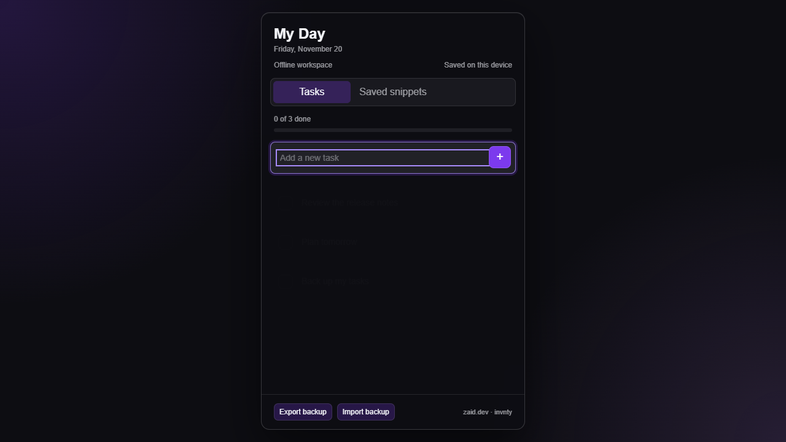

<div align="center">

# Daily ToDo Offline
### Your day. Your desktop. Your data.


**Coded by [zaid.dev](https://github.com/gamerock587) · invnty**
</div>



## A small home for your daily work

- Draggable desktop widget and system tray controls.
- Add, edit, complete and delete tasks with local persistence.
- Save clipboard snippets manually, search them and copy them back.
- Export and import validated JSON backups.
- No account, backend, cloud connection, telemetry or clipboard watcher.

## Run locally

Requires Node.js and Windows for the desktop build.

```powershell
npm ci
npm start
npm test
npm run build
```

Dependency installation requires internet; the app itself runs offline. You can also open index.html in a browser for the task interface; clipboard permissions depend on the browser.

Read [USAGE.md](USAGE.md) for widget controls and backups, [DESIGN.md](DESIGN.md) for UI conventions, and [RELEASE_REVIEW.md](RELEASE_REVIEW.md) for validation.

## Privacy

Tasks and manually saved snippets stay in this app's local Electron profile. JSON backups contain their text: keep backups private. This export starts empty and includes no personal task lists, accounts or credentials. Automatic startup is not enabled.

## Contributing and license

Use synthetic data in issues and pull requests. Original application code is [MIT licensed](LICENSE); dependencies keep their own licenses.
